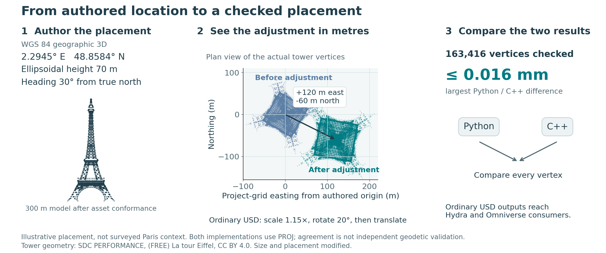
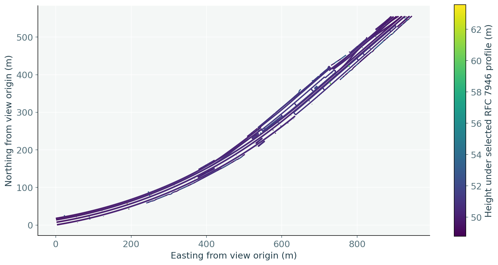
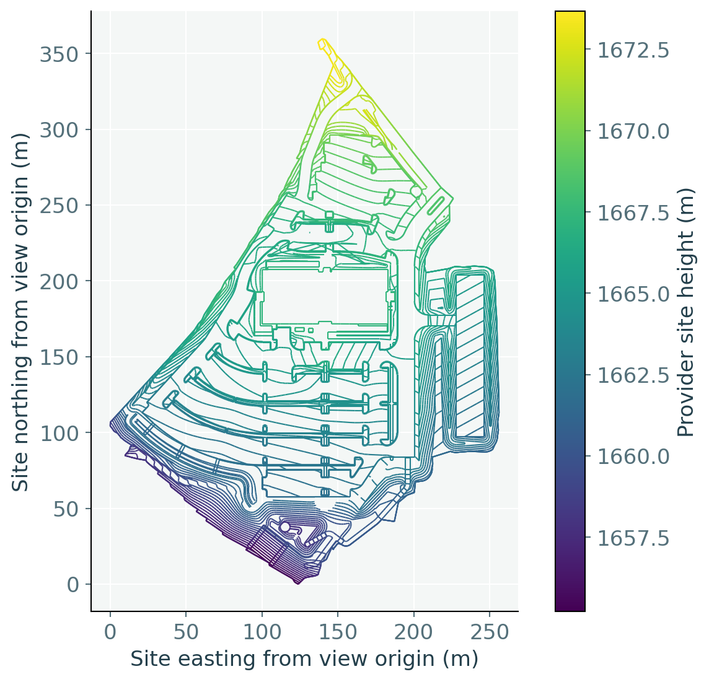
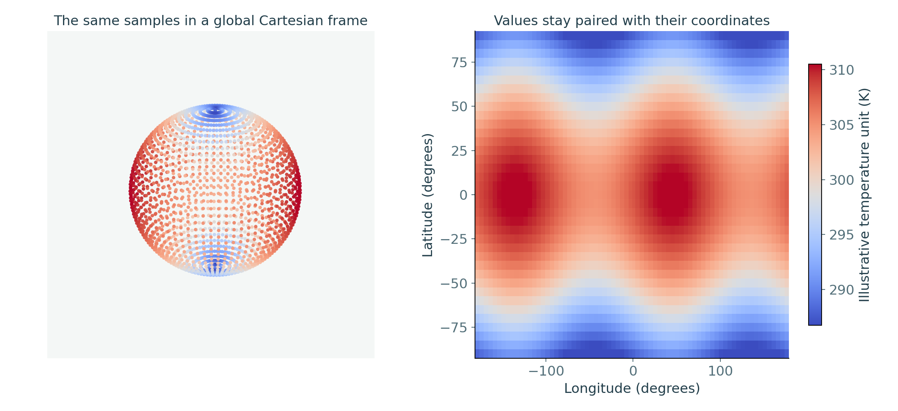
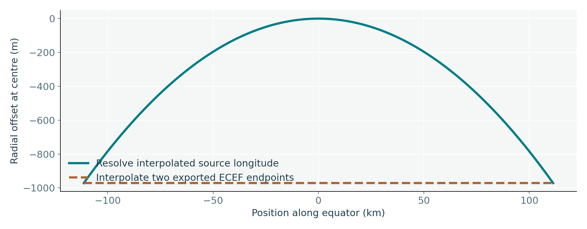

# Geospatial USD: proposal quality and working evidence

**Companion implementation: proposal review first.** This work assesses whether an
agent can implement the proposal as written, without inventing missing
data-model or runtime rules. The code, tests and visual examples are evidence
for reviewing the proposal. The package is a candidate OpenUSD contribution;
detailed implementation review and integration follow alignment on the proposal.

The companion uses the stable `aluk/geospatial-companion` branch and
`extras/usd/examples/usdGeospatial` package. It presents the latest delivered run;
the proposal revision and recorded checks below identify the evidence being
shown. Fresh build runs are preserved separately before delivery, as described
in the [build-loop contract](BUILD_LOOP.md).

Start with the [12-slide assessment PDF](delivery/output/Geospatial-USD-proposal-assessment.pdf)
or [editable deck](delivery/output/Geospatial-USD-proposal-assessment.pptx), then
the findings and linked evidence below. The
[current proposal text](https://github.com/Tamrat-B/OpenUSD-proposals/blob/geospatial-crs-proposal/proposals/geospatial_coordinate_reference_systems/README.md)
is the review destination. The recorded commit below identifies the revision
actually tested; the implementation's interfaces do not define the standard.

Fresh derivation from proposal commit `4120379fa12473b54a8f8e11999a1cefa5443614`,
23 October 2026. This README is the narrative source for the accompanying deck.
The proposal defines scene inputs and observable behavior; it does not standardize
the callable interfaces used by these examples.

To review the implementation, start with the [code and file review map](REVIEWING.md).
It pairs Python/C++ responsibilities and separates source, tests, supplied data
and generated results. [Reproduction commands](REPRODUCE.md) describe the checks.

## The tested workflows can be derived from the proposal

Two newly written placement readers pass 19 contract groups against the unchanged proposal. Its existing rules were sufficient to correct the implementation defects found during the run. No new blocking specification gap was found in these workflows, and no undocumented geospatial fields were needed. This is bounded evidence, not proof of exhaustive conformance.

**Evidence.** [Contract results](evidence/checks.json), [requirement trace and reverse audit](audit/source-contract.md), and [fresh-generation provenance](audit/authority.json). Original inputs were reused; previous geospatial implementations, fixture logic and generated expectations were not. The same agent wrote both readers, and both use PROJ. This is not an independent-team or independent-engine certification.

## Store inputs; compute results

A coordinate reference system (CRS) gives numbers their location, axes, units and height reference. USD stores that definition as well-known text (WKT), alongside the author's placement decisions. Projection effects and resolved positions are computed results; they do not become extra source USD properties.

| Authored input | Meaning |
|---|---|
| `crs:wkt` | One complete CRS definition, shared through composition |
| `crs:position` | Absolute model origin in that definition's components and units |
| `crs:orientation` | Physical heading, pitch and roll against geodetic east/north/up |
| Ordinary xformOps | Model-local descendants; project adjustments on the anchor |
| External-data association | Asset, format, selected field and coordinate domain |

**Evidence.** The codeless [schema resources](schema/plugInfo.json) contain the proposed input fields. There is no `crs:scale`, coordinate-epoch property, output-orientation property or private “already resolved” flag. WKT string normalization preserves quoted text and exact decimal information; semantic equivalence is tested separately from serialized identity.

## Placement has an explicit order

Child transforms first produce model-local geometry. Source position and physical attitude place it on the Earth. The anchor's ordinary scale, rotation and translation then act in a fixed working chart. Changing the requested output CRS preserves that adjustment instead of interpreting the same numbers along different axes.

| Stage of evaluation | What it preserves |
|---|---|
| Child transforms and asset conformance | Ordinary reusable model-local meaning |
| Source position and geodetic attitude | Physical origin, direction and local lengths |
| Conversion into the working chart | A fixed context for the anchor's adjustments |
| Anchor's complete ordinary stack | Authored scales, pivots, rotations and translations |
| Requested coordinate/scene output | Adjusted physical placement in the requested representation |

**Evidence.** Reset stacks, independently bound children, reference offsets, inherits, value clips and native instance proxies are exercised. Bound point-instancer prototypes retain their independent position, with the per-instance adjustment transported once. Identity adjustments avoid unnecessary intermediate conversions. Geographic queries return angles, while ordinary scene geometry uses the associated geocentric Cartesian chart.

## Provider examples check the coordinate interpretation

Across 123 comparison rows, both readers use equivalent realized operations and agree with the supplied provider tables within the predeclared 2 mm distance. The largest provider residual is 0.100 mm. These distances test interpretation and implementation agreement; they do not establish survey accuracy.

| Conversion | Rows | Largest provider residual |
|---|---:|---:|
| France: geographic to geocentric | 59 | 0.100 mm |
| France: CC49 to Lambert-93 | 59 | 0.061 mm |
| Colorado: State Plane to calibrated site | 5 | 0.034 mm |

*Caption: Provider tables also use PROJ; these checks do not establish independent geodetic or survey accuracy.*

**Evidence.** [France geocentric](evidence/france-geocentric-comparison.json), [France projected](evidence/france-projected-comparison.json), [Colorado calibration](evidence/colorado-calibrated-comparison.json). Actual operation pipelines were compared after removing serialization-only plus prefixes; the same local resource files were used. Cartesian residuals include unit conversion to metres, including US survey feet. Provider tables were themselves generated using PROJ, so these are useful external workflow references rather than an independent geodetic engine oracle.

## The same Eiffel geometry reaches ordinary USD consumers

The two readers resolve all 163,416 original Eiffel vertices, with a maximum difference of 0.016 mm between their ordinary bakes. A fresh reader reconstructs the Python bake within 0.011 mm. Native Hydra/Storm renders the derived geometry, and a real Omniverse stage reads the Python result back without a geospatial resolver.

*Caption: Authored placement, then USD adjustment. Tower: SDC PERFORMANCE, CC BY 4.0 (modified). Both readers use PROJ.*

**Evidence.** [Placement figure inputs and measured shift](evidence/tower-placement.json), [full-data comparison](evidence/full-data.json), [fresh-bake precision](evidence/tower-bake.json), [actual Hydra/Storm render](evidence/tower-storm.png), [actual Omniverse readback](evidence/omniverse.json). There are **two placement readers**, Python and native C++. Omniverse is a consumer of Python results, not a third implementation or an integration with an additional geospatial runtime. Both readers share PROJ; the native reader reads the composed USD inputs itself. Neutral export formatting is shared. The original artist asset receives explicit cm/Y-up conformance and an illustrative resize to 300 m before the shown project scale. The figure uses the authored location and heading, then shows the actual footprint before and after the anchor's scale, rotation and translation. Its project-grid origin moves 120 m east and 60 m south, matching the authored adjustment. The coordinate comparison reads every vertex from the two recorded ordinary USD bakes. This is an illustrative placement, not surveyed Paris context.

Tower geometry: [(FREE) La tour Eiffel](https://sketchfab.com/3d-models/free-la-tour-eiffel-8553f94d06e24cb4b0fde1080f281674),
by [SDC PERFORMANCE](https://sketchfab.com/Lambo_SC04),
[CC BY 4.0](https://creativecommons.org/licenses/by/4.0/). Asset conformance,
size, placement and display are modified in this example; the original archive
retains its embedded attribution.

## The original railway remains useful as data

Both readers resolve the same 15,822 railway positions and retain feature/geometry indices. The visualization uses those positions and preserves separate line sequences. A consumer can obtain coordinates and feature values without constructing renderable geometry, then ask for another supported output CRS.

*Caption: The selected RFC 7946 association defines height interpretation; the legacy source labels horizontal WGS 84.*

**Evidence.** [Railway coordinates and associations](evidence/railway-points.json). The source has a legacy EPSG:4326 horizontal label. The explicitly authored GeoJSON association selects the proposal's RFC 7946 profile, including its ellipsoidal third-coordinate meaning; it does not infer a datum from the numeric heights. A legacy declaration naming another CRS is rejected. This demonstration does not independently verify the producer's surveying accuracy or height provenance. Original file bytes remain unchanged.

## Site calibration survives the data exchange

The original Westminster data contributes 14,359 polyline positions, including 13,899 breakline points. Both readers retain the calibrated site's full WKT and US survey feet while converting the same records to the State Plane context. Horizontal and vertical calibration remain CRS meaning, separate from object placement.

*Caption: A query client supplies LandXML records and companion WKT; no standard LandXML USD association is claimed.*

**Evidence.** [Full-data results](evidence/full-data.json). There are 710 original polyline sequences; original ordering and associations are retained and no triangulation is invented. A coordinate-query client explicitly supplies the LandXML records with the provider's companion WKT. LandXML is not one of the proposal's native USD association profiles, and this run does not claim it is. The plot converts declared US survey feet into metres for display. Both readers agree to the recorded floating-point precision; that is not a statement of measurement accuracy.

## Global analysis does not require a renderer

The climate example pairs 2,664 original measurement values with explicit coordinates and two illustrative observation times, yielding 5,328 sample records. Both readers agree on their global geocentric locations. Changing a measurement time keeps its location association intact; the globe and heatmap are optional views of the same data.

*Caption: Added example inputs: Kelvin, zero ellipsoidal height, chosen observation times and a second field at +1 K.*

**Evidence.** [Climate comparison and time association](evidence/climate-comparison.json). The original download lacks the necessary CF roles, unit declaration, absolute height and observation-time metadata. The **illustrative derived wrapper** explicitly adds those facts: Kelvin as the example unit, zero ellipsoidal height, chosen example times and a second field equal to the first plus 1 K. These are demonstration inputs, not recovered weather observations. A separate CF permutation case proves coordinates align by named dimensions rather than independent flattened indices. GeoTIFF PixelIsArea and PixelIsPoint samples are also distinguished. CF metadata and WKT must agree; surface-relative height is not silently treated as absolute ellipsoidal height.

## A height fallback is visible and queryable

When a model placement lacks a vertical CRS, the specified fallback is EGM2008 gravity-related height, with a warning. At the illustrative Eiffel coordinate, 35 m in that reference resolves to about 79.639 m ellipsoidal height. The reader reports the source interpretation and whether it was declared or assumed; it authors no computed height properties.

| Source definition | Computed height report |
|---|---|
| Geographic 3D with ellipsoidal height | Ellipsoidal; declared |
| Geocentric X, Y, Z | No height axis; declared |
| Horizontal geographic CRS used for model placement | EGM2008 height in metres; assumed and warned |
| Horizontal projected CRS used for model placement | EGM2008 height in the horizontal linear unit; assumed and warned |

*Caption: Required grids are actually used. A missing grid fails visibly instead of substituting another height reference.*

**Evidence.** [Height and failure cases](evidence/checks.json), [isolated missing-grid failure](evidence/missing-egm-grid.txt). The EGM2008 grid was actually used. Removing it makes the request fail visibly; neither zero nor ellipsoidal height substitutes for it. A genuinely 2D measurement domain stays 2D and does not receive this model-placement fallback. Coordinate-epoch-dependent operations and wrappers remain outside initial scope, including when PROJ could perform them.

## Profiles lets a consumer detect the dependency early

Authors use the geospatial input schemas. Publishers maintain a conservative summary at advertised entrypoints, above payloads and across retained variants. Consumers read that summary before loading content: hard dependency, qualified known-none, or unknown. This helps adoption by making unsupported placement detectable instead of silently wrong.

| Participant | Observable contract |
|---|---|
| Author | Binding and measurement schemas imply the proposed capability |
| Publisher | ClaimsAPI records a complete, conservative publication summary |
| Consumer | Reads the summary without traversing or loading payloads |
| Ordinary geometry bake | May claim known-none after every retained dependency is removed |

*Caption: Native ClaimsAPI reads the declaration with zero payloads loaded. The capability names remain proposed.*

**Evidence.** The existing native `UsdProfilesClaimsAPI` reads the hard usage and publishing profile with **zero payloads loaded**. A stale summary is rejected; a hidden geospatial variant cannot justify known-none. Complete geometry bakes publish qualified known-none. The local capability registration uses existing Profiles metadata, not a new geospatial carrier. The proposed identities are `usd.geospatial.crsResolution.v1` and `usd.geospatial.publication.v1`; namespace stewardship and standards approval remain adoption questions. The dependency declaration is a publisher claim, not proof inferred by a consumer traversal.

## Sampling and coverage claims have practical limits

A two-endpoint ECEF bake does not preserve the source trajectory between those endpoints. The equatorial test exposes a 971.421 m midpoint difference. Exported sample keys and time-code scale record what was written; they do not claim an untested path or certify the continuous image of a face, curve or subdivision surface.

*Caption: The sampled bake claims its actual sample instants; it makes no between-sample trajectory guarantee.*

**Evidence.** [Sampled export case](evidence/checks.json). Ordinary double-precision transforms carry large motion while float points remain local at each exported sample. A fresh native reader reads the bake without a private resolved flag. The source remains unchanged. Finite-point and resulting straight-polygon bounds are distinct from continuous-domain certification; unsupported certification fails visibly.

## Separate proposal quality from prototype coverage

The fresh run found implementation defects and repaired them against existing requirements. It found no new blocking model or runtime ambiguity in the exercised contracts. Remaining review/adoption questions, explicit roadmap deferrals and prototype coverage limits are different claims and must remain visible when assessing readiness.

| Category | Current assessment |
|---|---|
| Missing meaning in tested contracts | No new blocking gap found; bounded evidence |
| Review and adoption | Detailed candidate conventions and Profiles identity ownership still require standards review |
| Explicit deferrals | Coordinate epochs and scene-authored operation/resource pinning |
| Prototype limits | General continuous-domain certification, custom GeoTIFF decoding and point-instancer bake expansion are visibly unsupported |
| Independence of evidence | Same author and PROJ family; provider tables also use PROJ |

**Evidence.** [Reverse audit](audit/source-contract.md). The audit caught implicit epoch handling, a float-frame precision defect, incorrect CF assumptions and an unnecessary working-CRS conversion. Their repairs required no extra USD source attributes. Semantic normal primvar transport is exercised; full combinations of indexed, animated and non-mesh export are not certified. Review claims are intentionally narrower than “all possible implementations will agree.”

### Reproduce and inspect

See [REPRODUCE.md](REPRODUCE.md). The [Python reader](src_py/reader.py),
[native reader](native/resolve.cpp), [new fixture generator](tests/fixtures.py),
[native-format adapters](src_py/domains.py), [ordinary exporter](src_py/bake.py)
and [acceptance cases](tests/run.py) were generated for this run. The build made
no source proposal edits. Its source and recorded evidence are published here
as a draft companion; the original freeze records describe the run before
publication.

The two readers use PROJ 9.5.1 and 9.4.1 respectively. The installed native USD
SDK is 26.11; Python's USD is 26.5. The native Profiles API supplies declaration
authoring/readback where the older Python bindings lack it. These version
differences are recorded implementation context, not geospatial source fields.

Original input hashes, code/resource provenance and the final assessment are in
[audit](audit/). Source and derived inputs have different provenance. Provider
files and the original artist asset retain their supplied licenses and credits;
this run does not infer redistribution rights or dependency approval.
