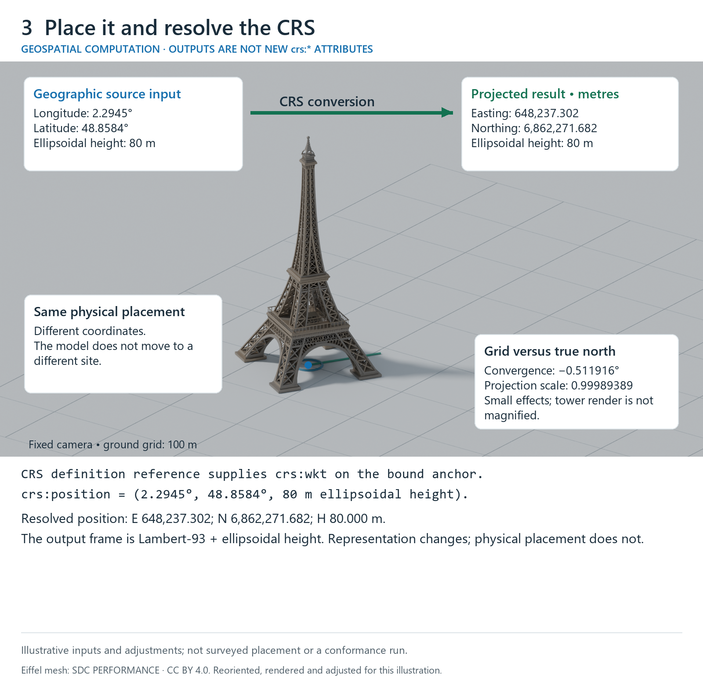
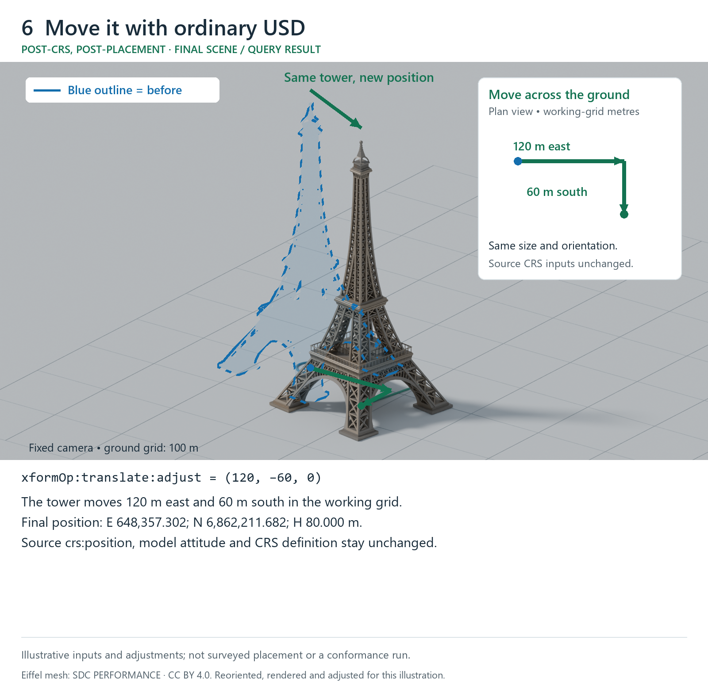
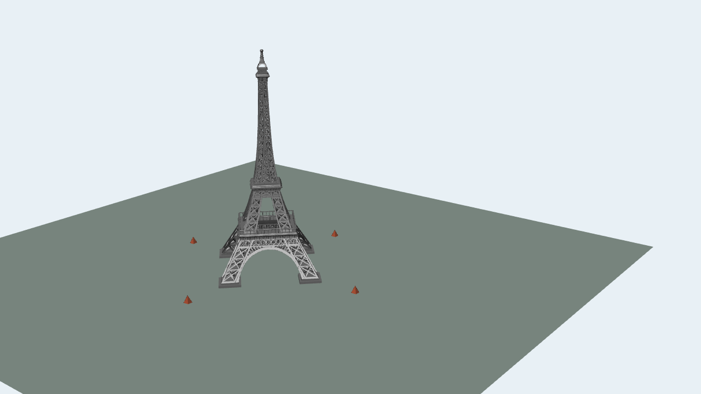
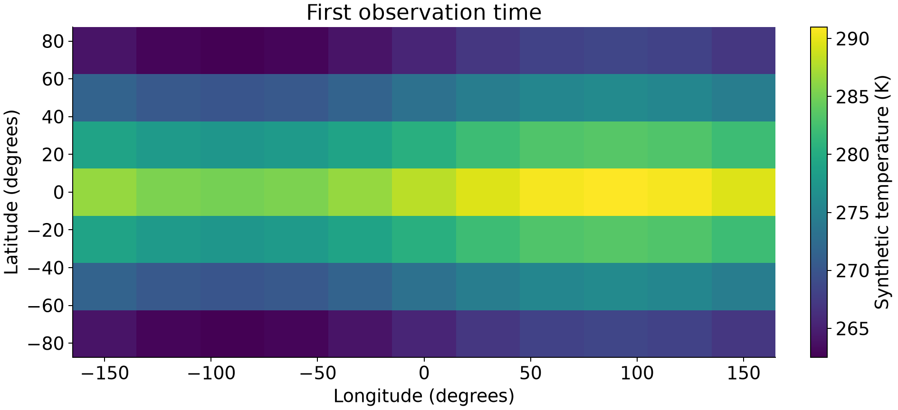
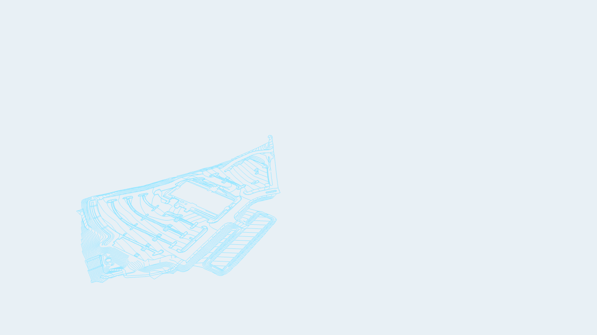
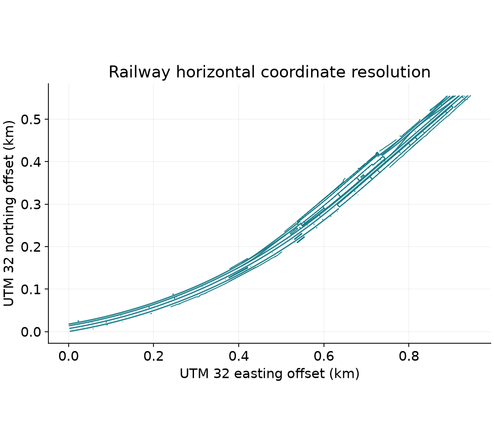
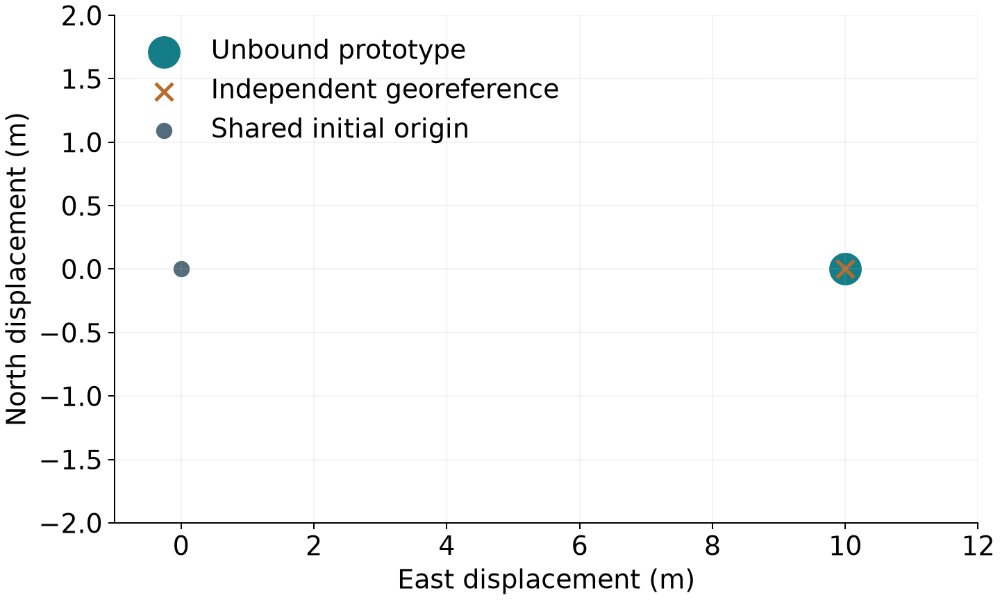

# Geospatial proposal assessment

USD describes a 3D model's shape and size. Geospatial information says where it belongs on Earth, so models, surveys and measurements can work together.

Proposal quality means that another implementer can derive the inputs, evaluation order and observable outcomes without guessing. The full draft specifies those rules for the workflows shown here.

Selected demonstrations support the proposed behavior. Detailed conventions still need group review, and three prototype limitations remain. This evidence does not establish exhaustive completeness or independent geodetic accuracy.

[Slides](delivery/geospatial-build.pptx) · [PDF](delivery/geospatial-build.pdf) · [Proposal snapshot](proposal/proposal-source.txt) · [Build loop](BUILD_LOOP.md)

## What the proposal covers

The initial scope combines local model placement, partner survey coordinates and native measurement domains. It retains geographic queries and global analytical use. Coordinate epochs and scene-authored transformation-resource controls are deferred while preserving a path to future support. Unsupported requests report their limits rather than inventing coordinate meaning.

## Source inputs and computed placement

### A geographic location for a 3D model

**Question.** Can a reader distinguish the model's shape from its location on Earth?

**Proposed rule.** The source records model geometry separately from its absolute origin and physical attitude. WKT supplies the coordinate meaning. Ordinary USD operations express intentional scaling and pivots.

**Expected behavior.** A reader can place the model without treating longitude or latitude as a distance or adding computed results to the source schema.

**Observed result.** The source stores position and one heading/pitch/roll tuple. Readers compute the physical pose, coordinate results and projection effects without writing them back.

**What this says about the proposal.** Inputs-only authoring gives the reader one authority for each meaning. The detailed field and pose conventions remain proposed.

**Limit.** The illustrated position is an example, not a surveyed Eiffel location. No crs:scale is proposed.

Proposal basis: [Authored properties](proposal/proposal-source.txt#L1540). Functional requirements 9, 10, 12, 14, 15.

| Source information | Plain meaning |
|---|---|
| Model geometry | Shape and local distances, with declared units and up direction. In USD: points, metersPerUnit and upAxis. |
| Coordinate reference | A CRS binding refers to WKT, the standard text description of the location's axes, units and height meaning. |
| Geographic origin | crs:position locates the model origin. The illustrative example uses longitude 2.2945°, latitude 48.8584° and ellipsoidal height 80 m. |
| Physical orientation | crs:orientation records heading, pitch and roll in degrees: which way the model faces and tilts against local east, north and up. |

WKT remains authoritative for coordinate meaning. Placement inputs add model position and physical attitude. Resolved positions, frames, projection scale and convergence are query results, not properties of the source schema. Intentional scaling and pivots use ordinary xformOps.

## Demonstrations and their meaning

### One physical place, different coordinates

**Question.** Does changing coordinate systems preserve physical placement?

**Proposed rule.** A CRS conversion expresses the same physical location in different coordinates. The reader derives map convergence and local scale from the authoritative WKT and position.

*Informative illustration. It explains the rule and does not verify surveyed Paris placement.*

**Expected behavior.** The coordinate numbers and units can change while the tower stays at the same physical place.

**Observed result.** Longitude, latitude and height become map coordinates. The physical site stays the same, while grid north and local scale can differ.

**What this says about the proposal.** A new coordinate representation has a defined physical meaning. The France and Colorado numerical controls test conversion separately from this illustration.

Proposal basis: [Source placement evaluation and transform order](proposal/proposal-source.txt#L1857). Functional requirements 9, 12, 13, 16, 19.

### Ordinary model adjustments after placement

**Question.** In which coordinates do an author's scale, rotation and translation operate?

**Proposed rule.** Child transforms define the model's local geometry. Geospatial position and attitude place that geometry. The directly bound model's own xformOps then adjust the placed result in a fixed project chart, before conversion to the requested output.

*Informative illustration. The chart and reset conventions remain proposed. Ordinary pivots follow the authored USD stack.*

**Expected behavior.** Changing the requested output CRS preserves the same physical adjustment. Child offsets continue to follow the model axes.

**Observed result.** The illustration scales by 1.15, rotates 20° and moves 120 m east and 60 m south. It shows adjustments on the directly bound model.

**What this says about the proposal.** The draft distinguishes project adjustments from model-local child offsets. A numerical control separates those interpretations by 4.222 m.

Proposal basis: [Evaluation](proposal/proposal-source.txt#L1957). Functional requirements 9, 14, 15, 17, 19.

### The same rules in two placement readers

**Question.** Can separate implementations derive the same coordinates from the proposed inputs and rules?

**Proposed rule.** Both readers use the composed source inputs and declared output CRS. Results include declared units and meaningful physical comparison.

**Expected behavior.** Python and C++ resolve the same partner points within the recorded comparison tolerance.

**Observed result.** The readers compare 213,243 coordinate results. The maximum measured physical difference is 3.39e-08 m.

**What this says about the proposal.** These cases support reproducible interpretation of the proposed behavior. Agreement alone cannot establish all rules or all input layouts.

**Limit.** Both readers use PROJ and share native dataset decoding. Agreement does not establish independent geodetic validation.

Proposal basis: [Extent and result comparison](proposal/proposal-source.txt#L2138). Functional requirements 4, 13, 16, 17, 18, 28, 29.

### Ordinary USD geometry for rendering

**Question.** Can a renderer use the result without implementing geospatial evaluation?

**Proposed rule.** An explicit bake resolves georeferencing into ordinary geometry and xformOps in a derived copy. A Cartesian coordinate context preserves location without an active source placement binding.

*Recorded native render. Ground context is illustrative. The image does not establish surveyed placement or surface-normal accuracy.*

**Expected behavior.** An ordinary USD renderer displays the derived copy. The source scene retains its authored inputs.

**Observed result.** Native Hydra/Storm renders the C++-resolved Eiffel bake. A double-precision origin keeps local geometry small.

**What this says about the proposal.** The visualization path uses ordinary USD geometry. Reassembly controls confirm that a parent translation and an authored reset keep their USD meaning.

Proposal basis: [Explicit export and sampling](proposal/proposal-source.txt#L2195). Functional requirements 17, 19, 23, 25, 29.

### Measurements stay paired with their locations

**Question.** Can a native measurement dataset remain usable without rewriting values or guessing coordinate meaning?

**Proposed rule.** The scene identifies the native asset, field and coordinate domain. Resolution preserves the pairing of values, locations, missing-data masks and observation times.

*Plot of recorded synthetic data. Synthetic temperatures in kelvin. Both readers share decoding, so their agreement alone cannot verify the association.*

**Expected behavior.** A measurement stays the same whether its location is returned geographically or in Earth-centred Cartesian coordinates.

**Observed result.** The global field returns geographic and Earth-centred positions for 154 samples, preserving native values and two observation times.

**What this says about the proposal.** The same data model supports global analytics as well as rendering. Named-dimension controls check the value/location association separately.

Proposal basis: [External measurement association](proposal/proposal-source.txt#L1641). Functional requirements 8, 12, 18, 19, 21, 30.

### France: CC49 to Lambert-93 (m)

| Resolved component | Python reader | C++ reader |
|---|---|---|
| Map east coordinate | 661,101.109417 | 661,101.109417 |
| Map north coordinate | 6,857,834.256536 | 6,857,834.256536 |
| Height | 37.298000 | 37.298000 |

### Colorado: State Plane to site grid (US survey ft)

| Resolved component | Python reader | C++ reader |
|---|---|---|
| Map east coordinate | 3,108,871.450101 | 3,108,871.450101 |
| Map north coordinate | 1,206,317.469403 | 1,206,317.469403 |
| Height | 5,484.677949 | 5,484.677949 |

## Proposal quality and its limits

| Review dimension | Assessment |
|---|---|
| Data model and runtime rules | The draft separates authored inputs from computed results and defines placement, adjustment, query and bake behavior. |
| Group alignment | The detailed orientation, frame, WKT string normalization and publication conventions remain proposed. |
| Prototype limitations | Lighting directions lack an error bound. Rotation uncertainty is unquantified. A quoted CRS name causes false rejection. |
| Verification coverage | Selected workflows and distinguishing controls support the rules. Broader composition and continuous space/time coverage remain unverified. |

No additional undefined model rule was confirmed in the inspected paths. That is a bounded finding. Passing results and matching readers cannot establish exhaustive completeness, group adoption or independent geodetic truth.

### Implementation and verification limits

| Topic | Finding |
|---|---|
| Normal transport | Confirmed prototype defect: one large projected face differs by 1.24 degrees across its domain. Centroid sampling has no justified domain/error bound. The source already requires a faithful derivative or covered approximation. |
| Near-half-turn numerics | The proposed failure rule is clear. The prototype's 64-epsilon guard lacks a demonstrated rotational uncertainty bound and a quantified native diagnostic. |
| WKT quoted text | Confirmed shared prototype defect: a valid CRS name containing COORDINATEMETADATA is mistaken for a deferred epoch wrapper. Capability detection must use WKT structure, not quoted text. |
| Publisher coverage | Retained-variant and unloaded-payload controls pass, including detection of a stale empty claim. This is not a production validator for every composition or variant combination. |
| Consumer coverage | Python and C++ share PROJ and external-data decoding. Omniverse reuses Python. General material/primvar baking, physics and nonlinear continuous space/time certificates remain unverified or visibly unsupported. |

The three prototype issues must be assessed against the proposed rules. A shortcut does not become a valid rule because both readers use it. Publisher controls cover selected retained variants and unloaded payloads. A metadata read alone cannot establish the truth of a completeness claim.

## Supporting workflows

### A construction site's own survey grid

**Question.** Can a project's local survey grid participate as a defined CRS?

**Proposed rule.** The source WKT describes how a calibrated site grid relates to a broader CRS, including its units and height meaning.

*Recorded native render. The survey-line image does not establish independent survey accuracy or a continuous terrain-surface certificate.*

**Expected behavior.** Partner survey lines resolve into the site grid without redefining the model units or up direction.

**Observed result.** The original LandXML survey breaklines resolve and reach an ordinary USD bake rendered by Storm.

**What this says about the proposal.** The partner case exercises a site's calibrated CRS. Its WKT-carried calibration participates in resolution.

Proposal basis: [Decision on question 7: site calibration](proposal/proposal-source.txt#L1304). Functional requirements 4, 14, 15, 17.

### Horizontal railway placement

**Question.** Can incomplete source metadata still support a useful, explicitly horizontal workflow?

**Proposed rule.** The reader resolves a declared horizontal association and preserves uninterpreted third components. It does not invent a height reference.

*Plot of recorded resolved geometry. Horizontal coordinates only. The original third components remain uninterpreted and supply no physical 3D distance.*

**Expected behavior.** The horizontal railway copy resolves into UTM 32 while the original GeoJSON remains unchanged.

**Observed result.** The horizontal copy resolves 15,822 vertices across 2,386 parts. The plot uses offsets only for display.

**What this says about the proposal.** The draft supports horizontal resolution without inventing a height reference. The original third components remain uninterpreted.

Proposal basis: [External measurement association](proposal/proposal-source.txt#L1641). Functional requirements 8, 12, 19, 21.

### Animation evaluation order

**Question.** Does the proposal define the result between authored moments?

**Proposed rule.** Interpolate the authored source position first, then convert coordinates. Physical orientation uses composed heading/pitch/roll samples and shortest-arc pose interpolation.

**Expected behavior.** The midpoint follows the source-defined path. An ambiguous half-turn requires an intermediate authored pose for interior-time evaluation.

**Observed result.** Equatorial longitude changes from 0° to 2°. Interpolating converted endpoints misses the source-first midpoint by 971.421 m.

**What this says about the proposal.** The order is testable. Sample keys alone cannot certify the original trajectory between samples.

**Limit.** The bake preserves time codes 0, 5 and 10 at 48 time codes per second. Continuous trajectory coverage remains unverified.

Proposal basis: [Evaluation](proposal/proposal-source.txt#L1957). Functional requirements 20, 29.

### Repeated models retain instance-local offsets

The draft expands a repeated model at its occurrence, keeps the prototype's independent geographic placement once, and transports the ordinary instance effect through the instancer frame. A required unavailable inverse fails.

In the synthetic control, an instancer-local +X offset moves two initially coincident prototypes ten metres east, whether they inherit a georeference or carry their own. Both readers return Earth-centred displacement [0, 10, 0] m. Rotation and scale controls also distinguish the frame choices. These controls establish the selected semantics, not surveyed placement or all instancer combinations.

### Physical separation and surface distance

At an explicit 400 km ellipsoidal height, a one-degree equatorial separation is 118.299 km in physical 3D and 111.319 km along the ellipsoid surface. The draft names these as distinct metrics. A horizontal-only coordinate supplies neither an invented zero height nor a physical 3D separation.

### Reusing a resolved bake

A +100 m ordinary parent moves a baked point from X = 6,378,137 m to 6,378,237 m. An authored reset retains X = 6,378,137 m. Both readers match ordinary UsdGeom. A typed CRS definition alone does not reset the ordinary stack. Stable entrypoints and metadata above payloads follow the [NVIDIA asset-structuring guidance](https://docs.omniverse.nvidia.com/usd/latest/learn-openusd/independent/asset-structure-principles.html) without prescribing a fixed scene hierarchy.

## Detailed conventions for group review

These are proposed definitions in the full draft. The demonstrations provide evidence for evaluating them; they do not make them adopted by the group.

| Placement topic | Proposed meaning |
|---|---|
| Physical orientation | One heading/pitch/roll tuple describes physical attitude against local east, north and up. Projection effects stay computed. |
| Project adjustments | The directly bound model's own xformOps adjust its placed result in a fixed project chart, including ordinary pivots. |
| Child objects | Child transforms define model-local geometry. Their offsets follow model axes and the geospatial attitude. |
| Repeated models | Each instance offset retains its instancer-local meaning. Independent prototype placement participates once. A required unavailable inverse fails. |
| Geographic scene results | Geographic queries retain longitude/latitude/height. Cartesian geometry and bounds use the datum's Earth-centred frame. |

| Data or declaration topic | Proposed meaning |
|---|---|
| Native data associations | Declare the asset, field and coordinate domain. Preserve named dimensions and observation times. |
| WKT string normalization | Normalize lexical spelling without losing represented information. Equal tokens establish serialized identity. |
| Semantic CRS comparison | Different normalized texts can represent equivalent CRSs. Comparison names its criteria and domain. |
| Dependency declaration | Existing Profiles metadata carries a proposed complete publication summary, including unloaded and retained variant content. |
| Baked coordinate context | Retain a Cartesian CRS and double-precision origin without an active source placement binding. Ordinary USD controls subsequent transforms. |

An absolute geographic measurement domain needs an explicit enclosing Cartesian project context for a nonidentity ordinary adjustment. Unadjusted geographic and Earth-centred queries remain supported, including global domains. Orientation follows the unique shorter physical arc. An exact half-turn needs an authored intermediate pose for an interior-time query, while exact-sample and held queries remain defined.

The proposed publication profile distinguishes complete-empty (known none), positive capability usage and unqualified/absent summaries (unknown, conservatively hard). Writers and assemblers maintain truthful coverage through retained variants and unloaded content. Profile registration and adoption remain pending.

## Evidence and its limits

| Path or check | Recorded evidence |
|---|---|
| Python and C++ readers | 213,243 coordinate results per reader. Maximum measured difference 3.39e-08 m. Shared PROJ and decoding. |
| Omniverse stage geometry | Reuses Python placement. Readback covers 177,872 vertices and 48 edit, failure and recovery checks across 39 jobs. |
| Hydra / Storm | Two selected ordinary USD bakes reach native rendering using C++-resolved placements. |
| Recorded tests | 113 contract tests and 65 distinguishing controls pass. Separate diagnostics expose the reported prototype limits. |
| Source preservation | Original inputs and 47 frozen execution files remain unchanged. The immutable receipt identifies exact executed content. |
| Bake readbacks | 11 selected exports checked. No general material/primvar, physics or continuous trajectory conformance is claimed. |

There are two placement readers. Omniverse reuses Python with a verified stage geometry sink. Hydra consumes a C++-resolved ordinary USD bake. This evidence establishes no third independent engine, Omniverse rendering, geospatial Hydra filter or physics integration. Polygonal vertex/face bounds do not certify the continuous image of a curved source surface or a trajectory between baked samples.

## Authority and reproduction

The README and deck explain the same pinned proposal and immutable execution. Collateral adds no normative authority.

Proposal commit: `7b5b34b7282305135f672663a3cffb0f94342ecc`. Proposal SHA-256: `010d4c0243e7e6985284cccadb00fb7c6f7b0c5c50f22d81bb31ada960548d75`. Execution source: `adab61d5aa33097c3f5f5166b5f6c326399fc5a5`. Immutable receipt SHA-256: `db39bc27bc04bf7f70bfaf2e5048b085798e3ef8b72e58fa54a367a51b7b6d91`.

[Receipt](delivery/run-report.json) · [31 requirement mappings](proposal/traceability.md) · [Diagnostic results](delivery/revised-leans-20261008/audit-diagnostics.json) · [Scope and publisher controls](delivery/revised-leans-20261008/scope-audit.json) · [Quoted WKT control](delivery/revised-leans-20261008/quoted-keyword-audit.json) · [Focused conformance controls](delivery/revised-leans-20261008/closure-audit.json)

Run comparison and execution history

[Recorded comparison](delivery/revised-leans-20261008/run-comparison.json) separates intended contract effects from regressions. Historical failure and repair records remain in the immutable execution directories. They are supporting evidence, not the structure of this assessment.

`collateral/revised_leans_delivery.py` extracts pinned evidence. `collateral/standalone_delivery.py` supplies this shared explanation and slide story. `collateral/revised_leans_slides.mjs` renders the story without adding presentation-only technical claims. The delivery review checks standalone meaning, evidence boundaries, literal source wording and every rendered slide.

Eiffel mesh: [SDC PERFORMANCE, Free La Tour Eiffel](https://sketchfab.com/3d-models/free-la-tour-eiffel-8553f94d06e24cb4b0fde1080f281674), [CC BY 4.0](https://creativecommons.org/licenses/by/4.0/). The diagrams use illustrative positions and ground context. Partner-data credit and permission remain in [data documentation](data/README.md) and [partner license](data/LICENSE-partner.txt).
