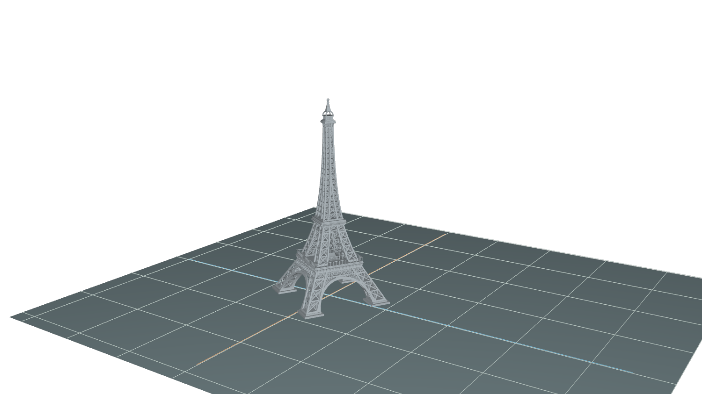
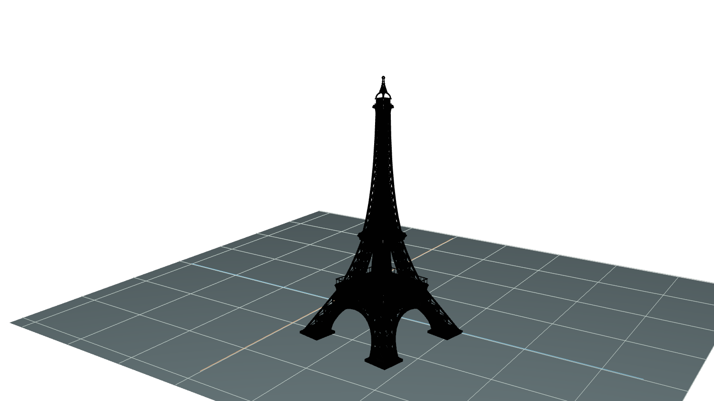
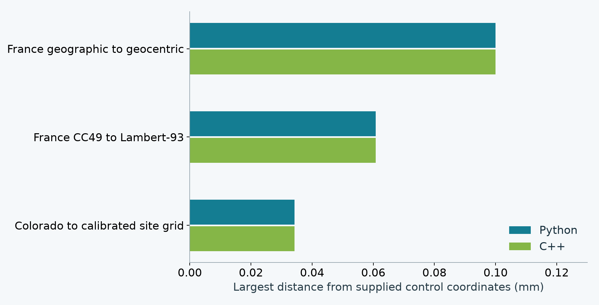
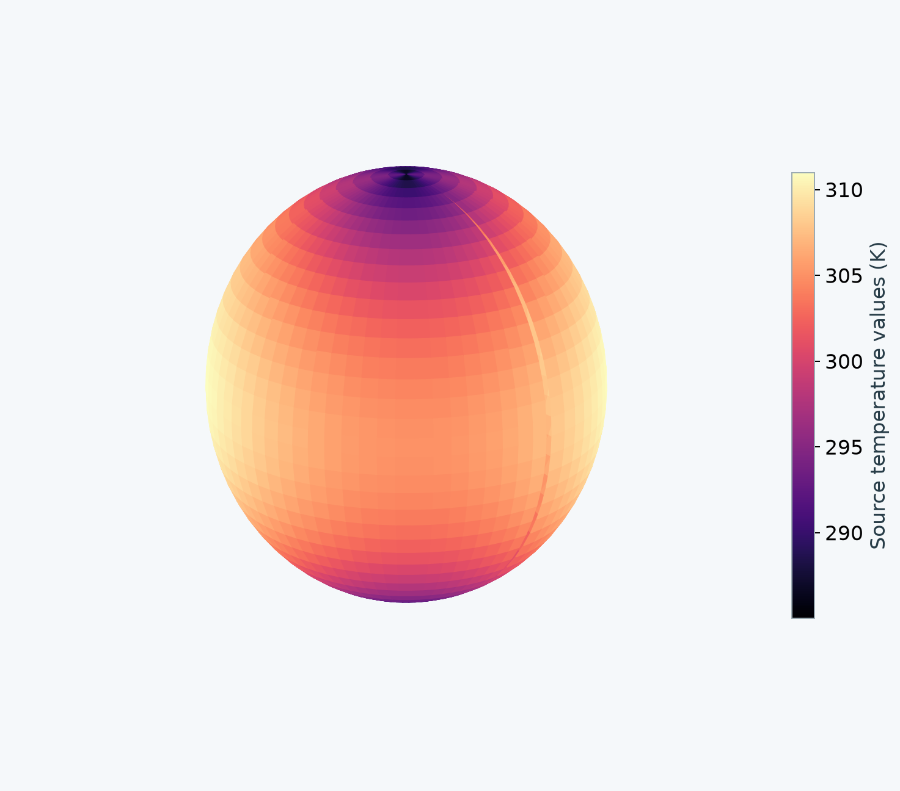
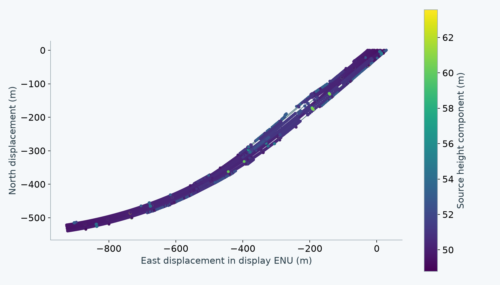
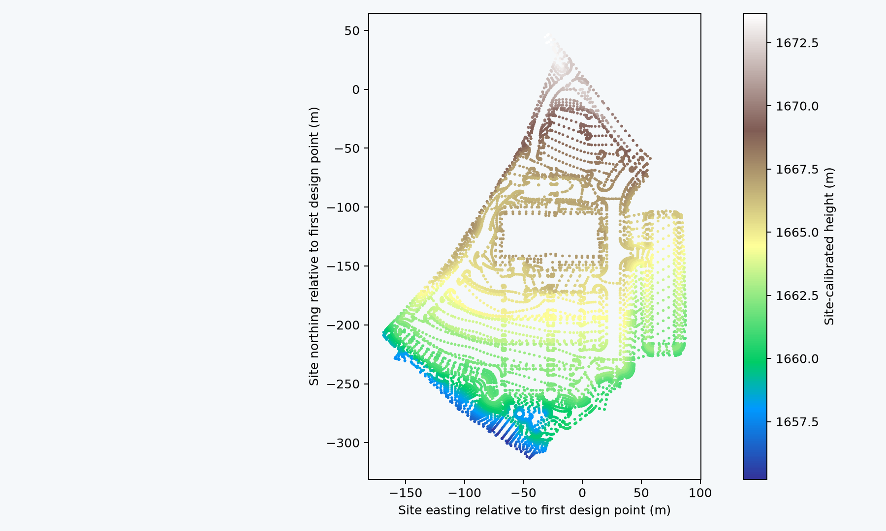
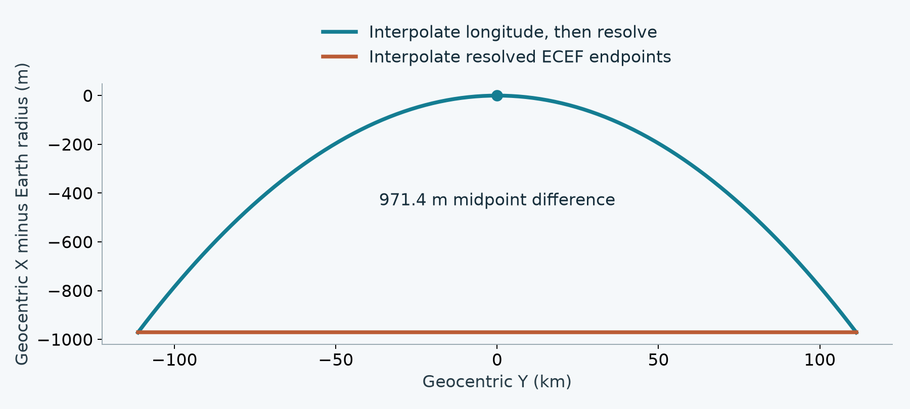

# Geospatial in USD: proposal quality and working evidence

The proposed data model and runtime rules are specific enough to derive the tested workflows from the text. This fresh Python and C++ implementation required no new geospatial source property or additional placement rule. The assessment is about those demonstrated contracts, with prototype coverage limits stated explicitly.

## Proposal quality

The exercised workflows revealed implementation defects and dataset limitations, rather than a new missing data-model decision. A working image alone would not establish that conclusion: the checks trace authored facts to required behavior, independent expected answers and visible failures.

The review candidate defines position and physical model attitude separately from ordinary transforms, keeps WKT authoritative, and specifies composition, interpolation, native-data association, Profiles and explicit baking. Those detailed conventions still require author approval. Implementation success does not establish group adoption or complete conformance.

The source was regenerated from proposal commit `9f15b1b46224fcd3b22f1a0d5ebf352965cf2d97`, with SHA-256 `7b7784019d125bf27523929501b72d134810f996a87e764ea0e82db3da120256`. The only proposal changes in that pin are Sébastien's informative grid/ground and France-example corrections. No proposal repair was added to justify this implementation.

## Authored inputs and computed results

An author records what the source means and how the model is placed. Consumers compute projected positions, convergence, scale, orientation and bounds. Those computed results are runtime data, rather than additional properties on the source.

| Authored input | Meaning |
|---|---|
| `uniform token crs:wkt` | One complete shared CRS definition, including its coordinate units and vertical reference. |
| `double3 crs:position` | Absolute 3D model origin in the source CRS's semantic component order. |
| `double3 crs:orientation` | Physical heading, pitch and roll in degrees against geodetic east/north/up. |
| Ordinary USD xformOps | Local asset transforms and intentional project adjustments, in their specified contexts. |
| External-data association | Native asset, format, selected field and coordinate domain. Values and times stay associated with their original samples. |

Writers normalize the WKT string losslessly. Readers accept supported valid non-normal spelling with a warning. Exact decimal rewriting preserves quoted content and CRS information. Equal normalized text establishes serialized identity; unequal text alone cannot establish different CRS meaning. See the referenced [OGC WKT2 standard](https://docs.ogc.org/is/18-010r11/18-010r11.pdf).

## Placement and ordinary USD adjustments

The tower first receives its physical attitude and CRS placement. The anchor's ordinary adjustments then act in the fixed working chart. Descendant transforms keep their model-local meaning, so a child offset follows the model's attitude.





Both views use the same camera and 100 m display grid. The placed model has a 30° clockwise heading from true north and an illustrative source position of longitude 2.2945°, latitude 48.8584°, ellipsoidal height 33 m. The second view applies ordinary scale 1.15, a 20° grid-Z rotation and translation `(120, -60, 0)` m. The nominal 300 m model becomes 345 m tall and its base moves east and south. Source placement inputs stay unchanged.

The original artist asset declares centimetres and Y-up. This example explicitly authors unit/up-axis conformance and a separate intentional 100× resize to obtain the nominal 300 m display model. Readers infer neither correction. Ground, neutral material overrides and camera are illustrative presentation context, not a surveyed Paris backdrop. The second image is an actual Hydra Storm render of the native C++ ordinary bake.

## Independent survey controls

Both readers reproduce the supplied France and Colorado coordinate tables within 0.101 mm in these cases. The acceptance distance was 2 mm before execution. The provider tables supply the expected answers independently of either implementation.

| Coordinate comparison | Rows | Largest Python error (mm) | Largest C++ error (mm) |
|---|---:|---:|---:|
| France geographic to geocentric | 59 | 0.100 | 0.100 |
| France CC49 to Lambert-93 | 59 | 0.061 | 0.061 |
| Colorado state plane to calibrated site grid | 5 | 0.034 | 0.034 |



The 123 rows are coordinate comparisons, including repeated France point IDs in different representations. They are not 123 independent surveyed sites. Reported distances convert each output component's length unit to metres. Full selected pipelines and local grid hashes remain in the evidence. Python and C++ use PROJ 9.8.1 and 9.4.1 respectively; this tests separately written readers, not independent geodetic algorithms. Agreement with rounded controls is not a survey-accuracy claim.

## USD Profiles and adoption

USD Profiles lets a consumer learn whether an asset requires geospatial resolution before traversing or loading its payloads. The publisher maintains the conservative declaration. A successful geometry bake can instead declare that ordinary USD is sufficient.

The candidate uses existing `ClaimsAPI` and `customData.profilesInfo` fields. The interface carries the summary outside payloads:

```usda
prepend apiSchemas = ["ClaimsAPI"]
customData = {
    dictionary profilesInfo = {
        dictionary capabilityUsages = {
            string "usd.geospatial.crsResolution.v1" = "hard"
        }
        dictionary profileCompatibility = {
            string[] "usd.geospatial.publication.v1" = []
        }
    }
}
```

| Declaration | Consumer conclusion |
|---|---|
| Hard geospatial usage | Resolution is required, including while content is unloaded. |
| Qualified complete summary, empty usages | No retained content requires geospatial resolution. |
| No hard usage and no complete summary | Coverage is unknown. Absence alone proves nothing. |

The tests exercise these states, reject a stale completeness claim that masks a retained dependency, and verify technical registration and schema-implied capability metadata. The binding and measurement schemas imply resolution; a CRS library definition alone does not. The consumer's summary read performs no traversal or payload load. Publishers must cover referenced content and retained alternatives conservatively.

The versioned identities above are proposed local registrations, not adopted standard names. Namespace stewardship and approval ownership still need agreement. Generic profile-compatibility queries also depend on their registered capability graph; they do not replace dependency discovery. See [USD Profiles](https://openusd.org/release/user_guides/schemas/UsdProfiles/overview.html).

## Measurements without a renderer

The same coordinate interpretation supports analysis as well as visualization, from project-sized data to global domains. Measurements retain their values, sample identities, masks and observation times while their locations resolve into the requested CRS.



The supplied climate demonstration container has 2,664 values but lacks the CF coordinate declarations required by the proposed association. Its observational provenance is unverified, and it stays unchanged. An explicit illustrative CF copy declares the coordinate interpretation and temperature units, synthetic zero ellipsoidal height and two times. Its second field is deliberately synthetic, the first field plus 1 K. The resulting 5,328 samples test association and time preservation, not observed climate evolution. The scientific plot uses resolved geocentric locations and supports larger-scale workflows without flattening the globe.

A separate permuted-dimension CF control uses nonconstant measurements, an explicit mask and two observation times. Both readers retain those associations. The GeoTIFF control checks pixel-centre positions and rejects a 3D request because the 2D raster supplies no height.

## Railway and calibrated construction data

The original railway and Westminster design data retain their coordinate meaning across the two readers. The run checks 15,822 railway positions and 13,899 construction design-breakline positions, alongside the independent survey controls.





The railway association uses its WGS 84 coordinates and explicit GeoJSON geometry/height semantics. The supplied legacy horizontal declaration is compatible; another legacy CRS would fail. The chart preserves the feature/geometry segment boundaries instead of connecting unrelated paths. Its ENU origin is a display choice, with no source edit.

Westminster uses the complete supplied derived horizontal and vertical site-calibration WKT. An explicit authoring converter wraps the LandXML breakline coordinates in CF while retaining the original numbers and breakline/point indices. This is a derived association copy, not a claim that LandXML is a proposed native association profile. The original XML contains design breaklines; this run invents no triangulation. The picture shows that original site grid, while numerical controls compare the resolved geocentric positions.

## Two readers and consuming applications

Python and native C++ independently read composed USD placement inputs. Omniverse consumes the Python-derived geometry through an actual application context stage. Hydra Storm consumes the C++ ordinary bake. These are two placement implementations and two consumer paths.

| Executed path | Evidence |
|---|---|
| Python reader | Resolves the original composed source and produces coordinates and an ordinary bake. |
| Native C++ reader | Reads USD and calls PROJ directly; it does not invoke Python placement. |
| Omniverse stage write/readback | All 163,416 Eiffel vertices match the supplied Python-derived ordinary geometry, with zero write/read difference. |
| Hydra Storm | Successfully renders the C++-derived ordinary geometry shown above. |

The Eiffel bakes differ by at most 0.00763 mm between readers. Ordinary double-precision origins and per-model translations keep float geometry local, including at sampled motion keys. Fresh ordinary readers and reassembly tests apply the origin once and retain enclosing ordinary transforms. Source layers and all 23 original files remain unchanged. A neutral Storm recording utility is reused infrastructure; geospatial schema, readers, fixtures and expectations are new.

The external-format decoder is shared transport. Both placement readers verify its association, source CRS and dimensionality, and then perform their own coordinate resolution. Omniverse reuses Python placement results and is not a third reader. This run makes no Fabric or other native geospatial-engine integration claim.

## Meaningful failures and coverage limits

The prototype rejects missing height, invalid bindings, blocked or wrongly typed inputs, unsupported axes, missing resources and epoch-dependent transformations. It also rejects an ambiguous 180° interpolated pose while retaining exact-sample and held evaluation.



The equatorial control places the source-interpolated midpoint on the surface. Interpolating only projected endpoints would miss by 971.4 m. Exported sample keys and `timeCodesPerSecond` record the actual bake schedule; they do not certify the original trajectory between those keys.

Finite vertex checks and the bounds of a resulting polygonal bake do not certify the nonlinear image of original faces, curves or subdivision surfaces. Continuous-domain certification is explicitly unsupported here. The prototype also rejects geometric point/vector/normal primvar export rather than copying those values incorrectly; ordinary mesh normals have derivative-based transport. GeoTIFF decoding currently supports IFD 0, and CF unit/role decoding covers the declared examples rather than the entire format standard. General inverse uniqueness and all composition/value-clip combinations have not been exhaustively verified.

These are implementation or verification limits against an explicit contract. They are not silently deferred data-model questions or evidence of complete conformance. The environment also reports a NumPy/native-format ABI warning; the executed data controls pass, but packaging still needs a consistent dependency environment.

## Review conclusion

The tested proposal contracts can drive a fresh implementation without inventing authored facts. Remaining review should focus on approving the concrete model/runtime conventions and Profiles ownership, while keeping prototype limitations separate from proposal completeness.

Coordinate epochs remain outside the initial scope, with a path for future representation and motion-model support. This run supplies no default height or epoch, no `crs:scale`, and no computed geospatial properties on source content. Larger-scale geographic data remains part of the demonstrated scope.

The source-generation record, pre/post implementation audits, test expectations and operation evidence support this assessment. [Reproduction details](REPRODUCE.md) distinguish authored datasets, derived copies, runtime results and presentation context. The README is the human source for the review summary and assessment deck.

Eiffel: [(FREE) La tour Eiffel](https://sketchfab.com/3d-models/free-la-tour-eiffel-8553f94d06e24cb4b0fde1080f281674), by [SDC PERFORMANCE](https://sketchfab.com/Lambo_SC04), [CC BY 4.0](https://creativecommons.org/licenses/by/4.0/). The example changes placement, scale and display materials. The original asset retains its embedded attribution. Partner data retains `inputs/original/LICENSE-partner.txt`. External grid files are runtime resources identified separately, not redistributed here.
