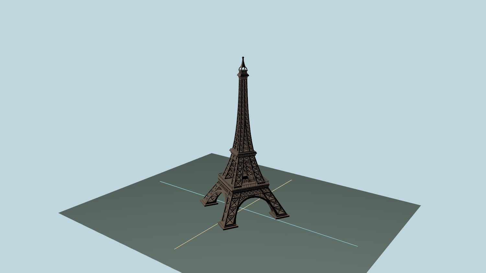
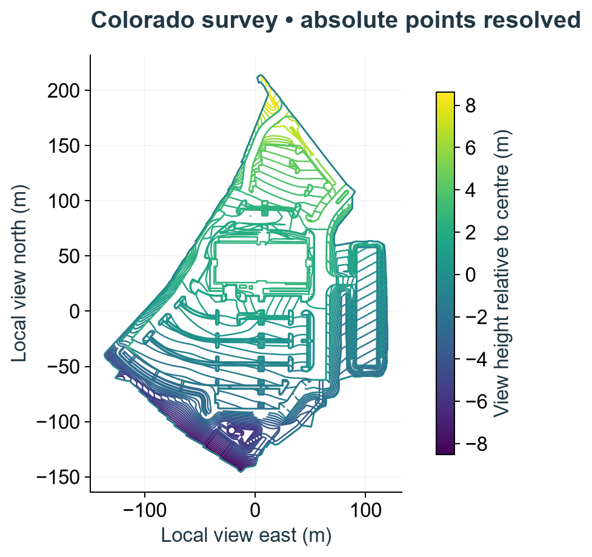
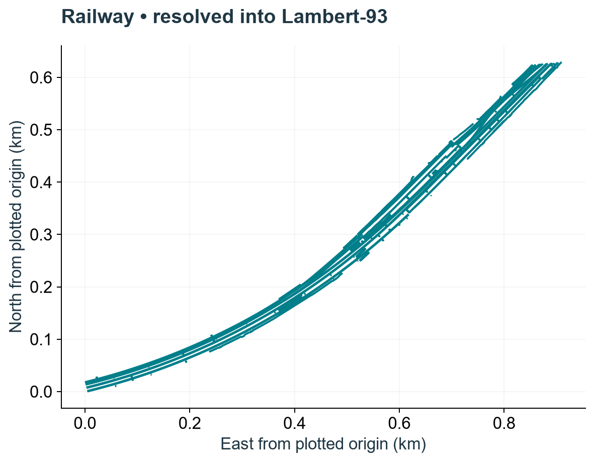
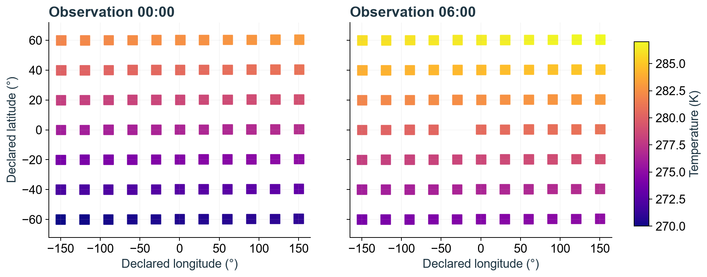
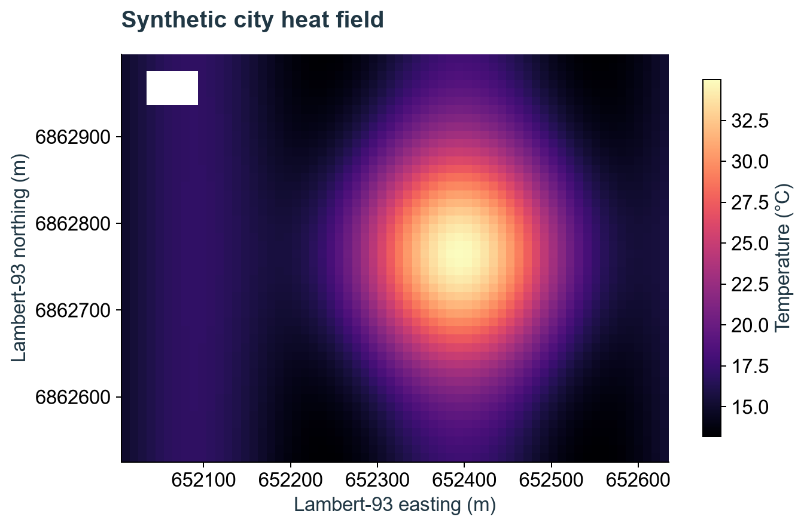

# Geospatial in USD: proposal quality and demonstrated behavior

The proposal can now drive a fresh implementation of the tested placement, measurement and dependency-discovery contracts. The new Python and C++ placement readers resolve the same original provider data and dense Eiffel geometry without adding source properties or changing the proposal. This is stronger evidence of derivability than repairing an existing prototype. It is not proof of complete conformance or independent geodetic accuracy.

**Assessment:** no new scene-meaning gap was found in the exercised paths. One Profiles integration clarification remains useful: dependency discovery and a generic compatibility query answer different questions. Registration still needs its explicit graph and agreed identities. Prototype coverage limits remain visible below.

Authority: proposal commit `e51919927ced49b9c68bcd86160be468121f633d`; SHA-256 `276ae17d60e9b4801947525528c98cfac58b25a7e6ac5999dc01ddb60a2e83b9`. The proposal was unchanged during this run. This assessment and the deck derive from the same evidence.

## A USD model gains a location, without changing what its points mean

The mesh describes shape in ordinary local lengths. WKT describes how to interpret an Earth location. A direct binding associates that definition with a model; `crs:position` records its absolute origin and `crs:orientation` records physical heading, pitch and roll against local geodetic east/north/up. Intentional scale and pivots remain ordinary xformOps. Computed positions, convergence, scale and bounds are results, not additional source USD properties.



This is the original 163,416-vertex Eiffel asset. The location, 30° heading and 35 m east / 15 m north ordinary adjustment are explicit illustrative author inputs. The asset’s incorrect cm metadata receives a documented ordinary writer correction. Ground, sky, material override and viewing camera are presentation context, not a surveyed Paris dataset or placement proof. Geometry comes from the native C++ evaluation; Storm consumes ordinary USD.

## The order of operations is part of the contract

1. Evaluate composed source position and orientation at the requested USD time. Position follows Core interpolation; orientation interpolates endpoint physical poses on the shorter arc. An ambiguous half-turn needs an intermediate authored pose.
2. Apply ordinary descendant transforms to the local detail; convert stage lengths and up axis to metric model ENU.
3. Orient and place that detail in the source datum. Preserve the complete WKT’s projection, calibration, units and height reference.
4. Apply the directly bound anchor’s ordinary xformOps in its fixed working chart, after intrinsic placement. A direct child binding is an absolute anchor; ancestor ordinary transforms do not add another placement.
5. Express the result in the requested CRS. Geographic coordinate queries return angles/height; ordinary scene geometry uses the associated Cartesian chart and a recorded numeric origin where needed.

Reference/inherit CRS sharing, nested bindings, descendant reset stacks, layer time offsets, value clips, geographic scene charts and transported independently bound instances all have executed controls. An identity instance needs no invented instancer anchor. Nonidentity transport requires its specified context and inverse.

## WKT string identity and shared placement

Normalization removes spelling differences such as spacing, preferred keyword aliases and decimal formatting without deleting CRS content. Quoted names, axes, units and authored operations remain meaningful input. Equal normalized tokens establish text identity; different normalized text can still describe equivalent CRSs. Resolver equivalence and exact-token matching answer separate questions. An analytic static-shift control confirms that the complete authored WKT operation survives model placement.

A CRS definition shared through reference and one shared through inherit produce the same composed interpretation in both readers. A directly bound child keeps its own absolute placement; a parent’s 1,000 m ordinary translation does not add to it. For a repeated independently georeferenced prototype at the equator, the specified instancer frame carries a 10 m east offset exactly once. Storage ancestors do not move the occurrence. An identity occurrence keeps placement without requiring a fabricated frame; a nonidentity adjustment without its required frame fails. Results retain standard instance ID/index and prototype-relative context.

These are finite, executed distinctions, not a claim that every inverse or every instance normal is implemented. The library, nested-binding and point-instancer controls separate composition meaning from implementation convenience.

## USD Profiles: authors declare, publishers maintain, consumers discover

Profiles makes the geospatial dependency visible before a consumer loads content. It uses existing `ClaimsAPI` metadata, not a new geospatial property.

| Role | Action | Executed evidence |
|---|---|---|
| Author | Bind a model or native measurement; its schema implies the proposed capability. | Fresh codeless schema registration and composed bindings. |
| Publisher | Record the conservative union for retained content and variants, outside payloads. | Required, qualified known-none, unknown and deliberately stale publications. |
| Consumer | Read the qualified summary without scene traversal or payload loading. | Python and C++ report the same states with **zero loaded payloads**. |

Illustrative composed metadata on a publication’s default prim:

```usda
dictionary profilesInfo = {
    dictionary capabilityUsages = {
        string "usd.geospatial.crsResolution.v1" = "hard"
    }
    dictionary profileCompatibility = {
        token[] "usd.geospatial.publication.v1" = []
    }
}
```

These are proposed identities. A qualified, explicitly recorded usage dictionary without the geospatial entry is known-none. Missing qualification is unknown and retains a conservative dependency. A stale known-none claim hiding a retained bound variant is rejected by the publisher audit. Discovery reads the claim; it does not prove its truth. A bare CRS library is known-none; a complete ordinary geometry bake can be known-none; a retained native measurement still requires resolution.

The local registration uses a publishing-profile graph rooted at `usd`. A labeled alternative rooted at the geospatial capability changes the generic `IsCompatibleWith` result. In this SDK, an empty usage dictionary yields `NoPath` even with the completeness claim. Neither result changes the proposal’s explicitly defined discovery semantics. **Clarify the distinction and supply the final registration graph; do not add fake usages or change scene meaning to make the generic query pass.** Namespace stewardship and approval remain adoption work. See [Profiles documentation](https://openusd.org/release/user_guides/schemas/UsdProfiles/overview.html).

## Independent provider controls, separate from reader agreement

Expected coordinates come from the providers’ paired CSVs, matched by point ID. Python was not used as the expected answer. France projected/height, geographic and geocentric data and Colorado projection/site calibration retain their complete WKT operations. Local RAF20 and GEOID18 resources are used with network access disabled.

| Provider source | Points | Largest error against provider | Python–C++ difference |
|---|---:|---:|---:|
| France 01 | 59 | 0.082 mm | 0 m |
| France 02 | 59 | 0.109 mm | 0 m |
| France 04 | 59 | 0.100 mm | 0 m |
| Colorado 02 | 5 | 0.021 mm | 0 m |
| Colorado 03 | 5 | 0.022 mm | 0 m |

The largest provider error is **0.109 mm**, below the stated 2 mm test tolerance. Provider coordinates are rounded; these errors do not certify survey accuracy. Operation-attributed accuracy is 1 cm for the tested France height pipelines, 1.5 cm for the tested Colorado pipelines and unknown for the tested geographic/geocentric operation. Agreement and attributed accuracy are different quantities.



The original LandXML supplies 14,359 absolute vertices in 710 parts, with north/east/height and US survey feet. A fresh producer importer maps those roles explicitly and resolves them without treating them as model offsets. The two readers agree exactly in the recorded output. LandXML is a producer import demonstration, not a fourth `data:format` in the schema. The local view is only a plotting convention.

## Native measurements keep values attached to the right locations

USD identifies a native asset, format, field and coordinate domain. The decoder uses explicit metadata roles and named dimensions; resolution changes the returned locations, not the values, masks or observation times.



The railway’s 15,822 coordinates are resolved horizontally. The original third components lack a confirmed height reference, so no 3D claim is made. The original file remains intact; the horizontal derivative is labeled.



The synthetic CF example has 154 samples, one masked, deliberately permuted coordinate dimensions and two observation times. All 153 valid samples agree between placement readers. The supplied original climate file lacks the role/unit/grid-mapping metadata needed for this association and is correctly rejected. Observation times are not coordinate epochs.



The GeoTIFF example retains all 3,072 cells and 24 masks; its 3,048 valid sample locations agree. Pixel centres and 2D height absence have separate controls. The native readers share this newly written format decoder; they do not share placement evaluation. These plots are analytics presentations, not Hydra or Omniverse renders.

## Two placement readers; explicit integration paths

| Path | What actually ran | Limit of the claim |
|---|---|---|
| Python reader | New composed-USD evaluator with PROJ. | Shared PROJ and native-format decoder. |
| Native C++ reader | New native USD-stage evaluator with independently written placement math and PROJ calls. | Common geodetic engine; not an independent geodetic oracle. |
| Omniverse stage writeback | External fresh Python results bridged into an Omniverse stage, then read back for all 163,416 vertices. | Integration, not a third placement engine or Fabric/ovstage resolver. |
| Native Hydra/Storm | `HdStormRendererPlugin` rendered a viewing copy of the C++ ordinary USD bake. | No geospatial Hydra filter was implemented. |

Dense Eiffel reader differences are at most **7.5e-09 m**. The float32 write/readback error is at most **0.011 mm**, reported separately. Fresh C++ and Python readers and an ordinary USD reader recover the same selected baked vertices; the double origin appears once. An explicit bake contains the actual Cartesian CRS definition and ordinary geometry/transforms in a derived copy. It is not a private “already resolved” flag.

## What the proposal audit found

**77 Python controls and 20 native controls pass**, alongside provider, sharing, dense-geometry and fresh-export checks. The post-implementation audit caught and repaired incorrect preferred WKT aliases, a native library collision, stale operation errors, unrequested export samples, short 3D tuples, compound geographic chart classification, epoch-boundary leakage, native CRS identification, malformed Profiles qualifications, bypassed authored WKT operations and missing instance identity. Their remedies came from existing normative text and primary library/specification references. No new source schema fields or model decisions were inserted to excuse the implementation.

WKT normalization uses the referenced OGC-preferred keywords, exact lexical decimal rewriting and quoted-content preservation. Text identity remains separate from CRS equivalence. Readers warn about supported valid non-normal WKT; they leave source layers unchanged. See [OGC WKT2](https://docs.ogc.org/is/18-010r11/18-010r11.pdf).

The required implementation choices are recorded: codeless plugin registration, PROJ operation factory and local resource search, interval arithmetic for the ambiguous orientation test, finite-point evaluation, and ordinary exporter hierarchy. Those choose algorithms or integration; they do not choose new source meaning. The publishing-profile graph is explicitly labeled as a local registration choice pending clarification.

**Limits:** nonlinear derivatives, general vector/normal transport and continuous surface/time bounds are not certified; their unsupported paths fail visibly. The occurrence exporter refuses authored instance normals and does not claim arbitrary material-graph closure. Complete native-format coverage, nested conditional-variant enumeration and formal ISO grammar validation are not demonstrated. Successful sample queries do not close those implementation/coverage limits. Coordinate-epoch wrappers remain deferred and are negative controls, preserving a path to later support.

## Reproducibility and delivery

The geospatial source, schemas, adapters and fixture writers were newly authored from the pinned proposal. Original data and generic libraries/tooling were reused. No previous geospatial implementation source or output was consulted before the first candidate freeze. Corrective generations have retained provenance receipts. Previous delivery collateral was inspected only after freezing, to match its human clarity.

All original dataset hashes and the proposal hash remain unchanged. The final candidate hash audit reports no source drift. This is one agent’s fresh derivation, not a blinded separate-implementer study. Earlier runs were incremental and are not relabeled as fresh.

Evidence is in `evidence/`; source-to-contract trace is in `authority/derivation.md`; generation inputs and hashes are in `generation-record.json`. Build the native reader with `native/build.cmd`, generate fixtures with `tests/fixtures.py` and `tests/make_workflows.py`, run the contract controls, then `tests/run_workflows.py` and `tests/native_controls.py`. The recorded Windows environment uses the generic USD SDK, the TIFF-enabled PROJ library and offline resources identified in the manifest. The deck is derived from this README and the same numerical receipts. It is a local deliverable; nothing was pushed or posted.

Eiffel asset credit: original Sketchfab asset and its embedded CC BY 4.0 attribution are retained. Partner dataset license: `data/LICENSE-partner.txt`.
